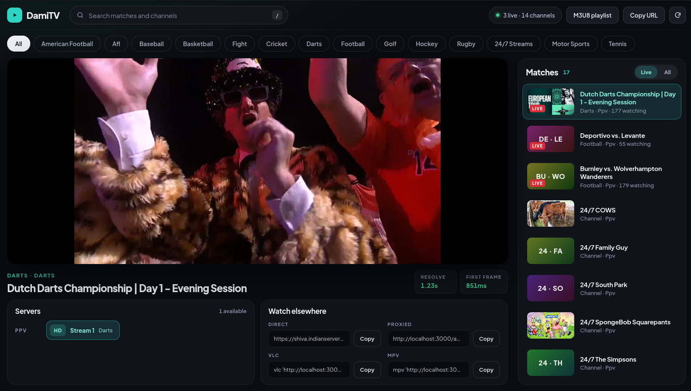

<div align="center">

# 📡 DamiTV HLS Stream Resolver

**Self-hosted HLS stream resolver for [DamiTV](https://damitv.st) live sports.**

Turn any match + server selection into a playable `m3u8` — replaying the embed handshake, decrypting
the `gasm` wasm response, and serving a local HLS proxy that injects the required `Referer` while
unwrapping **WEBP**-disguised segments into raw **MPEG-TS**.

[](https://nodejs.org)
[](https://www.docker.com)
[](https://www.typescriptlang.org)
[](https://github.com/video-dev/hls.js)
[](#-contributing)
[](LICENSE)

[Features](#-features) · [Quick Start](#-quick-start) · [Docker](#-docker) · [Usage](#-usage) · [How It Works](#-how-it-works) · [API](#-http-api) · [Disclaimer](#-disclaimer)



</div>

> [!IMPORTANT]
> **Based on:** [Lunatic16/streamed-pk-resolver](https://github.com/Lunatic16/streamed-pk-resolver) —
> this project mirrors that resolver's architecture, conventions, and UI, adapted to DamiTV's API
> (`damitv.st/papi`, the same streamed.pk API family).
>
> This project is for research, interoperability, and personal playback only. Respect upstream ToS,
> copyright, and local law — see the [full disclaimer](#-disclaimer).

## ✨ Features

- 🔓 **gasm unlock** — replays the embed `/fetch` protobuf handshake and decrypts the response with the vendored `gasm.wasm` in a happy-dom sandbox (worker-isolated, one worker per unlock)
- 🛡️ **Chrome TLS fingerprinting** — Impit `chrome151` transport for CDN pulls that would otherwise 403 (JA3-filtered)
- 🧩 **WEBP → MPEG-TS unwrap** — segments ship disguised as images; the proxy detects the RIFF/WEBP wrapper per response and streams raw TS out without buffering whole segments
- 🚰 **Referer-aware HLS proxy** — local `/api/hls` endpoint rewrites playlists and injects `Referer`/`Origin` for players that can't set headers; slot-hinted relays re-mint expired tokens automatically
- 🖥️ **Built-in player** — hls.js with official-embed buffer tuning (`maxBufferSize: 0`, `liveSyncDurationCount: 7`)
- 📋 **External player exports** — copy-paste VLC and mpv commands that point at the local relay, no referrer flags needed
- 🏟️ **Live catalog** — browse sports, live matches, and ranked HD/SD servers straight from `damitv.st/papi`; dead feeds are probed and filtered out of the live list
- 🗓️ **Live / All scope toggle** — flip the rail between live events and the full schedule; upcoming matches show live countdowns ("in 2h 15m") and sort by start time, with poster thumbnails and a LIVE pill
- 🌐 **Audio-language selector** — feeds that ship separate audio renditions (e.g. Rally TV's English/日本語/Deutsch/Español tracks) expose an in-player picker backed by hls.js audio groups
- 👆 **Click-to-play overlay** — when the browser blocks autoplay, a play button appears instead of failing silently; if the policy still refuses, playback starts muted and the native controls unmute
- 🔁 **Retry on failure** — the error banner carries a Retry button that re-runs the exact last action (re-resolve the chip, re-list the match, or reload)
- ⌨️ **Keyboard-friendly** — `/` focuses the match search from anywhere, `Esc` clears it
- 📺 **Dynamic IPTV M3U8 playlist** — one-click download or copy a live `.m3u` of every listed match/channel; entries are slot-based and unlock fresh at tune-in time
- 🔧 **Copy that works everywhere** — clipboard with an `execCommand` fallback for plain-HTTP LAN access
- ⚡ **Streaming pipes** — responses are piped, so first-byte latency tracks upstream TTFB
- 🐳 **Docker ready** — multi-stage build, non-root runtime user, compose file included

## 🚀 Quick Start

### Prerequisites

- **Node.js 18+** with ESM support (or **Docker**)
- Network access to `damitv.st`, the embed host, and the upstream CDN

### Install & run (Local Node.js)

```bash
git clone <your-repo-url> damitv-hls-proxy
cd damitv-hls-proxy
npm install
npm start
```

Open **http://localhost:3000**. The `start` script builds TypeScript and runs `dist/server/main.js`.

| Command | What it does |
| --- | --- |
| `npm start` | Build and serve UI + API |
| `npm run build` | Compile server, client, and wasm vendor into `dist/` |
| `npm run typecheck` | Type-check without emitting |

Default listen port is `3000` — override with `PORT`.

## 🐳 Docker

### Using Docker Compose (Recommended)

```bash
docker compose up -d
```

```bash
docker compose logs -f
docker compose down
```

### Using Docker CLI

```bash
docker build -t damitv-hls-proxy .
docker run -d --name damitv-hls-proxy -p 3000:3000 --restart unless-stopped damitv-hls-proxy
```

### Environment variables

| Variable | Default | Purpose |
| --- | --- | --- |
| `PORT` | `3000` | HTTP listen port |
| `FETCH_TIMEOUT_MS` | `15000` | Upstream fetch timeout |
| `DAMITV_API_BASE` | `https://damitv.st/papi` | DamiTV API root (`/sports`, `/matches/*`, `/stream/*`) |
| `DAMITV_EMBED_ORIGIN` | `https://taifood-blog.asia` | Embed player origin (wasm handshake host) |
| `PUBLIC_ORIGIN` | — | Public base URL for every generated link (relay URLs, playlist entries). Set behind a reverse proxy; otherwise `X-Forwarded-Proto`/`X-Forwarded-Host` are honored, then `Host` |
| `CORS_ORIGIN` | `*` | `Access-Control-Allow-Origin` for API responses |
| `USER_AGENT` | Chrome 126 UA | `User-Agent` sent to the API and upstream streams |

### Reverse proxy

Behind nginx/Caddy/Traefik the server picks the public origin up from
`X-Forwarded-Proto` / `X-Forwarded-Host` automatically (make sure the proxy
forwards them, e.g. nginx `proxy_set_header Host $host;
proxy_set_header X-Forwarded-Proto $scheme;`), or pin it with
`PUBLIC_ORIGIN=https://tv.example.net`. All relay URLs and playlist entries
follow. API responses carry permissive CORS (`CORS_ORIGIN`) and `OPTIONS`
preflight is answered, so the JSON API is consumable from other origins.

## 🎮 Usage

The home page is a three-column live sports workspace:

| Column | What you get |
| --- | --- |
| **Matches** | Live/All scope toggle, sport tabs, search (`/`), poster thumbnails, LIVE pills, countdowns for upcoming events |
| **Player** | Stage title, resolve / first-frame timing, hls.js playback, audio-language selector, click-to-play overlay, and copy fields for Direct, Proxied, VLC, and mpv |
| **Servers** | Stream links for the selected match (HD/SD badge, language, viewers) — click a chip to resolve and play |

Flow is always **match → server → play**. Resolve does not run until a server chip is chosen. After
a successful unlock, the proxied URL drives the in-page player; the Direct URL is the CDN master
playlist, intended for players that can send the embed `Referer` on their own.

> [!NOTE]
> **Autoplay** — browsers block unmuted playback without a user gesture. When that happens the
> player shows a click-to-play overlay; clicking it plays with sound, and under strict policies it
> falls back to muted playback (unmute via the player controls).

> [!TIP]
> If your player can't set `Referer` headers, use the **Proxied** `/api/hls` link instead — the
> local server attaches the headers, rewrites nested playlist and segment URLs, and unwraps the
> WEBP-disguised segments for you.

> [!NOTE]
> Stream tokens are live and short-lived, and the CDN load-balancer rotates hosts. If playback
> dies, resolve again — slot-hinted relays re-mint automatically on rejection.

### 📺 IPTV playlist

The top bar has **Download M3U8 Playlist** and **Copy M3U8 URL**. Both follow the selected sport
tab and produce a standard `#EXTM3U` playlist of every live match and channel, each entry labeled
`Title — Stream N (HD/SD)` and grouped by sport. Entries are slot-based
(`/api/hls?source=…&id=…`): the unlock runs at tune-in time, so tokens are always fresh, and
re-tuning a channel heals an expired stream automatically.

```bash
vlc http://localhost:3000/api/playlist
mpv --playlist=http://localhost:3000/api/playlist
```

## 🧠 How It Works

```
Browser ──► Node http server (Web Request/Response adapter)
             ├── /api/resolve  ──► embed /fetch handshake ──► gasm.wasm decrypt ──► secure m3u8
             ├── /api/hls      ──► referer-aware relay: playlist rewrite + WEBP→TS unwrap
             ├── /api/playlist ──► slot-based dynamic M3U (IPTV)
             ├── /api/sports, /api/matches, /api/streams ──► damitv.st/papi (20s TTL cache)
             └── static client (dist/client)
```

1. **Catalog** — `/papi/matches/live` (live + `always_live` 24/7 channels) and `/papi/matches/all`
   are cached for 20s and normalized; the live scope probes each match's stream endpoint and hides
   dead feeds.
2. **Unlock** — the server POSTs `<embed-origin>/fetch` with a protobuf body (`field 1 = embed id`),
   reads the `island` response header, and hands both to the vendored `gasm.wasm` inside a
   happy-dom sandbox running in a worker thread (one worker per unlock). The decrypted secure URL
   is harvested from wasm linear memory. All happy-dom DOM classes are mirrored onto the worker's
   global scope — the glue's `instanceof` guards read global constructors, and `document` must be
   bound to its real constructor or the wasm bails before any fetch.
3. **Master playlist** — the secure URL is served as-is (never collapsed to one variant): players
   pick the best variant themselves and keep the separate audio-rendition groups
   (`EXT-X-MEDIA`) that several feeds deliver — collapsing would silently drop audio.
4. **Relay** — `/api/hls` detects playlists by content-type or `.m3u8` path, rewrites every URI
   (including `URI="…"` attributes inside tags) back to itself, injects `Referer`/`Origin`, and
   unwraps WEBP-disguised MPEG-TS segments on the fly (floor to 188-byte packets, abort upstream
   once the TS body is complete). CDN pulls ride Impit's chrome transport — the CDN rejects plain
   runtime TLS fingerprints.

## 📡 HTTP API

| Endpoint | Description |
| --- | --- |
| `GET /api/health` | Proxy health + upstream liveness |
| `GET /api/sports` | Sport list as `{ id, name }[]` |
| `GET /api/matches?sport=<id>&scope=live\|all\|popular` | Normalized `Match[]` (default scope `live`) |
| `GET /api/streams?matchId=<id>` | `{ match, streams }` for one match |
| `GET /api/streams?source=<src>&id=<id>` | `{ streams }` for one upstream slot |
| `POST /api/resolve` | `{ matchId?, source?, id?, stream? }` → `{ ok, m3u8, referer, relay }` |
| `GET /api/playlist?sport=<id>&download=1` | Dynamic slot-based M3U of live matches + channels |
| `GET /api/hls?url=<encoded>&referer=<encoded>` | Referer-aware HLS relay (playlists rewritten, segments unwrapped) |
| `GET /api/hls?source=<src>&id=<id>` | Slot mode: unlock runs at tune-in time, response URIs rewritten to url-mode |

## ⚠️ Disclaimer

This project is for research, interoperability, and personal playback only. It does not host,
rehost, or redistribute any media. Playback relies on DamiTV's own embed infrastructure. Respect
upstream terms of service, copyright, and local law.

## 🤝 Contributing

PRs welcome — keep changes aligned with the reference architecture
([streamed-pk-resolver](https://github.com/Lunatic16/streamed-pk-resolver)): TypeScript ESM,
strict mode, Web-standard `Request`/`Response` handlers, worker-isolated unlock.
